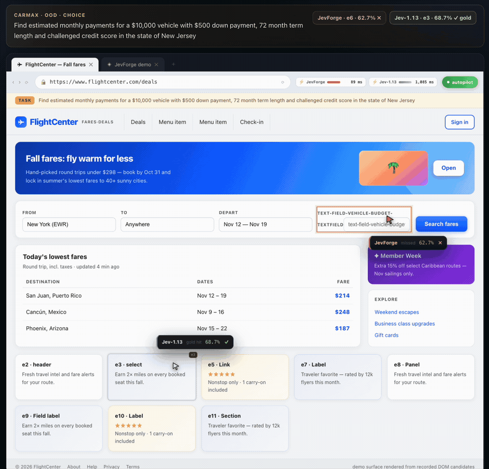
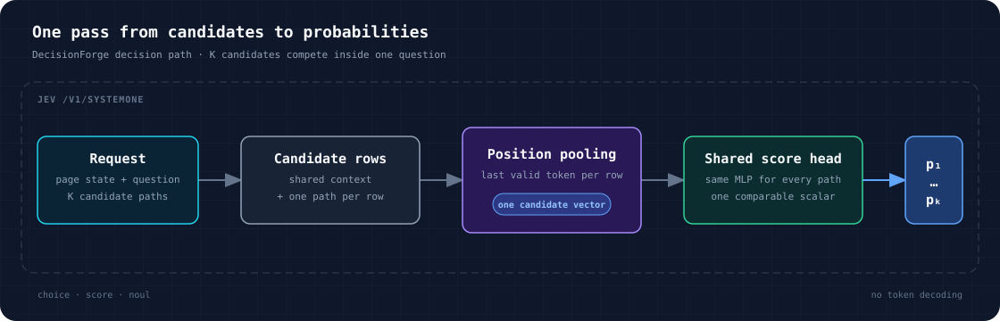

<div align="center">


# DecisionForge

**An end-to-end toolkit for synthesizing decision data, training calibrated
candidate scorers, evaluating them, and serving Jev-compatible inference for
interactive web decisions.**

Data synthesis · training + calibration · evaluation · Jev-compatible serving

[Interactive demo](https://decision-forge-pi.vercel.app) · [HF model](https://huggingface.co/AndeyTait/DecisionForge-0.8B) · [HF dataset](https://huggingface.co/datasets/AndeyTait/DecisionForge-Mind2Web) · [Dataset format](docs/DATASET.md) · [Design](docs/DESIGN.md) · [RLCD results](docs/RLCD_RESULTS.md)

</div>

DecisionForge turns structured decisions into one reproducible pipeline. Give it a
state, a question, and a candidate set; it builds training records, trains and
calibrates a scorer, evaluates fixed splits, and serves a complete probability
distribution through a Jev-compatible API. `choice`, `noul`, and ordered
`score` questions all use the same decision path.

Its first proving ground is the interaction loop at the heart of Jev-style
systems: choosing the next click, navigation target, form control, route, or
escalation from the elements currently available on a page.

<p align="center">
  <a href="https://decision-forge-pi.vercel.app">
    
  </a>
</p>

## Results

Results use fixed, website-disjoint test and OOD splits. The 0.8B and 0.6B
models share the same data and evaluation protocol; Jev-1.13 is shown as a
separate reference arm.

| Metric | Raw Qwen3.5-0.8B¹ | DecisionForge 0.8B | DecisionForge 0.6B | Jev-1.13 |
|---|---:|---:|---:|---:|
| Test choice top-1 | 0.235 | **0.579** | 0.439 | 0.543 |
| OOD choice top-1 | 0.340 | **0.637** | 0.500 | 0.610 |
| Test noul accuracy / Brier | — | 0.826 / **0.128** | 0.776 / 0.170 | 0.910 / 0.092 |
| OOD noul accuracy / Brier | — | **0.860 / 0.117** | 0.769 / 0.175 | 0.825 / 0.131 |
| Test / OOD score MAE | — | 0.367 / **0.390** | 0.488 / 0.481 | **0.348** / 0.463 |

¹ The raw-backbone row is a zero-shot scoring reference on the first 200
records of each frozen split; the trained and reference arms use their recorded
full evaluation sets.

## Decision architecture



DecisionForge expands one question into K rows. Every row contains the same page
state and question plus one candidate path. It pools the final valid token,
applies the same two-layer GELU scorer to every candidate, then normalises only
the K logits belonging to that question. This keeps candidate scores comparable,
preserves uncertainty, and avoids language-model decoding.

Backbone and checkpoint details are in [MODEL_CARD.md](MODEL_CARD.md).

## Run the model and watch it click

On an Apple Silicon Mac, one command downloads the 0.8B checkpoint from
Hugging Face, selects MPS, starts the local Jev-compatible API, and opens a
live page. The page shows the model's measured latency and full candidate
distribution before clicking the selected DOM element.

```bash
bash scripts/run_mac_demo.sh
```

## API quick start

```bash
python -m venv .venv
source .venv/bin/activate
pip install -r requirements.txt

python -m decisionforge.serve \
  --checkpoint-dir checkpoints/DecisionForge-0.8B \
  --port 8123
```

```bash
curl localhost:8123/v1/systemone \
  -H 'content-type: application/json' \
  -d '{
    "state": "Task: open privacy settings. Elements: [e1] Settings, [e2] Submit, [e3] Privacy",
    "questions": {
      "next": {
        "type": "choice",
        "instructions": "Which element should be used next?",
        "criteria": {"e1": "Settings", "e2": "Submit", "e3": "Privacy"}
      }
    }
  }'
```

## Reproduce the 0.8B run

The recipe builds website-disjoint records from Mind2Web annotations, adds
label distributions for missing decision fields, fine-tunes the pretrained
0.8B backbone with cross-entropy and Brier objectives, calibrates the resulting
distribution, then evaluates on the frozen splits.

See [Dataset format](docs/DATASET.md) for the field mapping, complete JSONL
example, split rules, and custom-domain data contract.

```bash
bash scripts/qwen35_08b_pipeline.sh
```

Training metrics can also be tracked with [Weights & Biases](https://wandb.ai/760243703-renmin-university-of-china/decisionforge/runs/4bdfb291).

## Preliminary RLCD support

DecisionForge includes an initial calibrated-decision reinforcement learning path
for browser choices. It combines grouped action sampling, browser-task utility,
a proper Brier calibration objective, and KL anchoring to the supervised
checkpoint. Gold-preserving hard-negative views can be added without changing
the frozen dev, test, or OOD records.

| Full-split metric | Supervised 0.8B | Browser RLCD |
|---|---:|---:|
| Test choice top-1 | 0.5787 | **0.5863** |
| OOD choice top-1 | 0.6373 | **0.6477** |
| Test choice mass on valid actions | 0.4491 | **0.4881** |
| OOD choice mass on valid actions | 0.4790 | **0.5328** |

```bash
python -m decisionforge.augment_browser \
  --records data/web_full \
  --output-dir data/web_browser_augmented \
  --views 1

RECORDS=data/web_browser_augmented \
RUN_NAME=qwen35-0.8b-rlcd-browser \
bash scripts/rlcd_qwen35_08b.sh
```

See the [method notes](docs/RLCD_RESEARCH.md),
[full ablation table](docs/RLCD_RESULTS.md), and
[W&B run](https://wandb.ai/760243703-renmin-university-of-china/decisionforge/runs/wgve64v4).

## Repository layout

```text
decisionforge/    schema, encoding, model, training, inference, serving, evaluation
scripts/     reproducible data, training, evaluation, and release commands
docs/        design notes and implementation details
examples/    small synthetic records that can be validated locally
```

The interactive site is maintained separately and deployed at
[decision-forge-pi.vercel.app](https://decision-forge-pi.vercel.app).

## Research roadmap

- [x] End-to-end decision data, training, calibration, evaluation, and serving
- [x] Jev-compatible `choice`, `noul`, and ordered `score` inference
- [x] Website-disjoint evaluation and interactive decision replay
- [x] **Initial calibrated-decision reinforcement learning** — grouped policy
  updates, proper probability scoring, reference KL, and browser augmentation.
- [ ] **General structured decisions** — extend to intent routing, tool/API
  selection, safety triage, document classification, and risk scoring.
- [x] **Controlled Qwen3.5-0.8B run** — same fixed data and evaluation protocol,
  initialised from upstream pretrained weights and reported as its own arm.

## Data and licensing

- Code: MIT, see [LICENSE](LICENSE).
- Model: [DecisionForge-0.8B](https://huggingface.co/AndeyTait/DecisionForge-0.8B).
- Dataset: [DecisionForge-Mind2Web](https://huggingface.co/datasets/AndeyTait/DecisionForge-Mind2Web).
- Provenance and upstream terms: [THIRD_PARTY_NOTICES.md](THIRD_PARTY_NOTICES.md).
- Jev-1.13 is reported as a separate reference arm.

DecisionForge is a personal, independent research project exploring open
structured-decision models and Jev-style interfaces.
